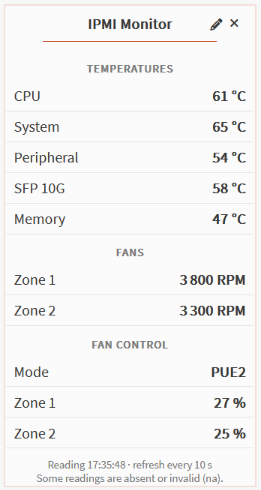
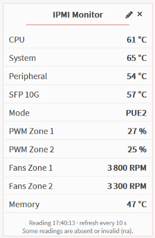
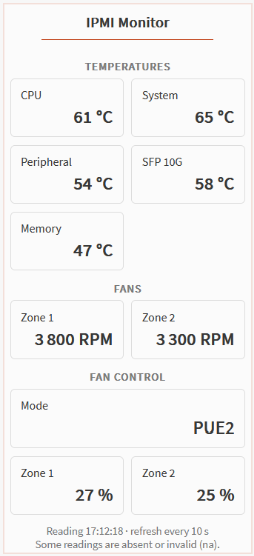
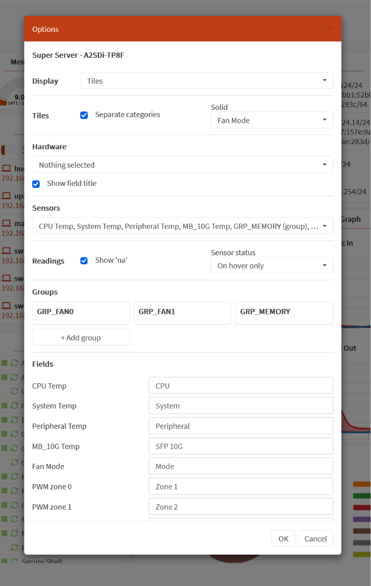

# os-ipmi-monitor

**A configurable, read-only IPMI dashboard widget for OPNsense.**

os-ipmi-monitor displays hardware readings and system information directly on the OPNsense dashboard. It discovers the sensors exposed by the local BMC through `ipmitool`, including temperatures, fan speeds, voltages, and other SDR readings. On supported Supermicro systems it also reads the current fan mode and PWM values. It does not set fan speeds, change BMC settings, reload firewall rules, or alter network configuration.

> **Project status:** Preparing the initial commit. The widget has been tested directly on an OPNsense gateway without a package. Native package building, installation, upgrade, removal, and repository distribution still need validation before a packaged release. There is no downloadable `.pkg` or official OPNsense repository entry yet.

## Screenshots

| List | Compact | Tiles |
| --- | --- | --- |
|  |  |  |

Configuration:



The screenshots show an A2SDi-TP8F test system. Available sensors and values depend on the motherboard, BMC, connected fans, and installed hardware.

## Features

- Automatic discovery of the local BMC's SDR readings; a board profile never hides newly discovered sensors.
- Configurable list, compact, and tile presentations, with optional category separation and sensor status display.
- Configurable reading refresh interval: 2, 5, 10, 20, 30, 60, or 120 seconds.
- Sensor selection and customizable display labels: for example, show `CPU Temp` as `CPU` without changing the sensor name reported by the BMC.
- Calculated groups: combine compatible sensor readings into one displayed value using their mean, median, or maximum. For example, a fan group can summarize several fan speeds, while a memory group can summarize DIMM temperatures. Users can edit groups; selected Supermicro board profiles provide initial suggestions.
- Optional hardware identity fields from FRU, BMC, SMBIOS, and the FreeBSD processor model. These fields are not selected for display by default.
- Read-only Supermicro OEM readings for fan mode and two PWM zones. Support for other vendors' OEM readings is not implemented.
- XML-based localization selected from the OPNsense dashboard language. English and French are the two languages currently supported.
- Access to the data through an authenticated OPNsense API and the `Diagnostics: IPMI read-only` privilege.

The widget refreshes readings every 10 seconds by default. The interval can be changed in the widget options to 2, 5, 20, 30, 60, or 120 seconds. Short intervals may be limited by the time the BMC takes to respond; the widget does not start a second reading while one is in progress. Hardware inventory has a separate one-hour cache, so its slower FRU and BMC queries do not run on every widget refresh. Missing or invalid readings are reported as unavailable; the widget can show or hide them.

## How it works

```text
OPNsense dashboard widget (Ipmimon.js)
    -> authenticated SnapshotController API
    -> configd actions (snapshot / inventory)
    -> Python collector
    -> local ipmitool -I open / FreeBSD system information
    -> BMC and motherboard sensors
```

The **front end** is an OPNsense dashboard widget in `src/opnsense/www/js/widgets/Ipmimon.js`. It renders readings, hardware fields, groups, and the options dialog. Widget preferences, including selected sensors and labels, are handled by the dashboard. Localization currently uses XML catalogs in `src/opnsense/www/js/widgets/Locales/`: the widget selects `Ipmimon_fr_FR.xml` for a French dashboard and `Ipmimon_en_US.xml` otherwise. `Metadata/Ipmimon.xml` declares the widget metadata and English source strings. Only English and French catalogs are supplied today; integration with OPNsense's standard translation workflow remains future work.

The **back end** consists of an authenticated PHP API controller, two configd actions, and `src/opnsense/scripts/ipmimon/collector.py`. The snapshot action runs `ipmitool -I open sensor list` and returns structured readings. The separate inventory action reads `ipmitool -I open fru print`, `ipmitool -I open mc info`, and local FreeBSD system identifiers. The Supermicro provider contains the fixed, read-only OEM commands for fan mode and PWM readings, plus the FRU/BMC parsers. Commands are fixed in the source; widget settings cannot supply shell commands or IPMI arguments.

Board-specific initial sensor and group suggestions live in `src/opnsense/scripts/ipmimon/providers/supermicro_boards.xml`. Profiles cover selected A2SDi, X10SDV, X11SDV, and X12SDV models. A profile is chosen from FRU or SMBIOS identity when available. Suggestions are applied only when a widget has no saved choices, and only sensors actually reported by the BMC appear in a suggested group. Fan-zone membership is configured only where supported by board documentation or the tested A2SDi-TP8F installation. Other boards and BMC firmware revisions need hardware verification.

The API routes are `/api/ipmimon/snapshot/get` and `/api/ipmimon/snapshot/inventory`. Inventory may contain serial numbers and asset tags; grant the read-only privilege only to accounts that should see that information. The widget does not show those fields by default.

## Next phase: fan mode control

A future phase could let users change the BMC fan mode on motherboards that explicitly support it. The interface would show only modes supported by the detected board, keep fan-mode changes separate from sensor readings, and require a dedicated write privilege and an explicit user action. The implementation would need board-specific commands and validation against real hardware before release. The current project has no fan-control action or write command: fan mode and PWM values are displayed for information only.

## Requirements

- An OPNsense version with the dashboard widget and MVC API paths used by this project.
- A local IPMI/BMC interface accessible to `ipmitool -I open` and the OPNsense `ipmitool` package.
- Python 3, PHP, and configd as supplied by the target OPNsense installation.

The plugin does not load the IPMI kernel driver. If `/dev/ipmi0` is absent, configure the `ipmi_load=YES` tunable in **System → Settings → Tunables** and check the device after a planned restart. A missing IPMI device does not prevent the UI from loading, but live readings will be unavailable.

## Installation and first use

**Current development installation:** Sources have been copied to a test gateway for direct testing. The deployment helper and connection details used for that gateway are deliberately kept under the Git-ignored `work/` directory and are not part of this repository's installation procedure.

**Future local package installation:** Once a package has been built and validated on a matching OPNsense release and architecture, install `ipmitool` from the configured OPNsense repository and, as root on the target system, run:

```sh
sh scripts/install.sh /path/to/os-ipmi-monitor-1.0.0.pkg
```

The installer checks the package name and then uses `pkg add` without forcing a replacement. If the target still has the earlier manually copied files, follow the migration steps in `scripts/legacy.py` before package installation; the package pre-install check refuses to overwrite unowned files. Keep a full OPNsense configuration backup and record the backup directory created by the migration tool.

After installation, reconnect to the web interface, grant **Diagnostics: IPMI read-only** to the intended users, and add **IPMI Monitor** to the dashboard. Check the options dialog to select sensors, hardware fields, groups, display style, and labels. The command `configctl ipmimon snapshot` provides a direct read-only check from the OPNsense shell; `configctl ipmimon inventory` checks the separate inventory path.

For package removal, use the OPNsense package interface or `pkg delete os-ipmi-monitor`. The package removal hook restarts configd; it does not remove saved dashboard preferences or IPMI driver tunables. Package lifecycle behavior still needs end-to-end testing.

## Building the package

Packaging is prepared around the official [OPNsense plugins framework](https://github.com/opnsense/plugins/blob/master/Mk/plugins.mk). Build on an isolated FreeBSD/OPNsense system matching the intended release and architecture, with an official `opnsense/plugins` checkout, the required build tools, and `ipmitool` already installed. Do not build on a production firewall.

From this repository's root, as root on the build system:

```sh
python3 -B scripts/build_package.py \
  --plugins-tree /usr/plugins \
  --maintainer 'MAINTAINER_EMAIL' \
  --website 'https://PROJECT_URL' \
  --license LICENSE_ID
```

Replace the metadata placeholders with real values. A license identifier and the corresponding license text must be chosen before distribution; this repository does not choose one implicitly. The build script runs Python tests and PHP syntax checking, stages the plugin under the official plugins tree, and invokes `make package`. It refuses to overwrite an existing staged plugin directory. The expected output is under `dist/packages/`, which is ignored by Git. `VERSION` and `PLUGIN_VERSION` in `Makefile` must be updated together for a new release.

A built package alone does not make the plugin available in OPNsense's package manager. Repository publication requires a signed `pkg` catalog, HTTPS hosting, and explicit repository configuration on clients. See [Publishing and signed repository preparation](docs/PUBLISHING.md). This publication flow has not yet been exercised for a release.

## Development checks

```sh
python3 -B -m unittest discover -s tests -p 'test_*.py' -v
node tests/test_dynamic.mjs
php -l src/opnsense/mvc/app/controllers/OPNsense/Ipmimon/Api/SnapshotController.php
```

The latest source staging on the test gateway completed 24 Python tests and the PHP syntax check. That staging did not install the new files. Package build and lifecycle tests remain open.

## Repository layout

| Path | Purpose |
| --- | --- |
| `src/opnsense/www/js/widgets/` | Dashboard widget, metadata, and English/French catalogs |
| `src/opnsense/mvc/` | Authenticated API and access privilege |
| `src/opnsense/service/conf/actions.d/` | configd actions and cache durations |
| `src/opnsense/scripts/ipmimon/` | Collector, Supermicro provider, and board profiles |
| `scripts/` | Package build, local install/removal, legacy migration, and repository preparation |
| `tests/` | Collector, widget, and packaging checks |
| `docs/PUBLISHING.md` | Detailed signed-repository workflow |

The OPNsense package name is `os-ipmi-monitor`; the internal widget and API namespace is `Ipmimon`.
